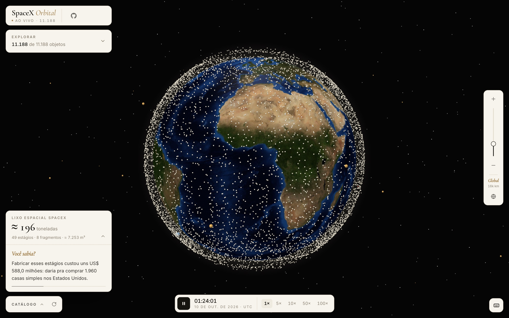
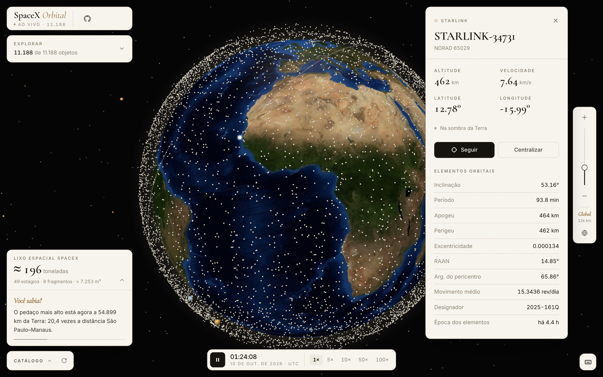
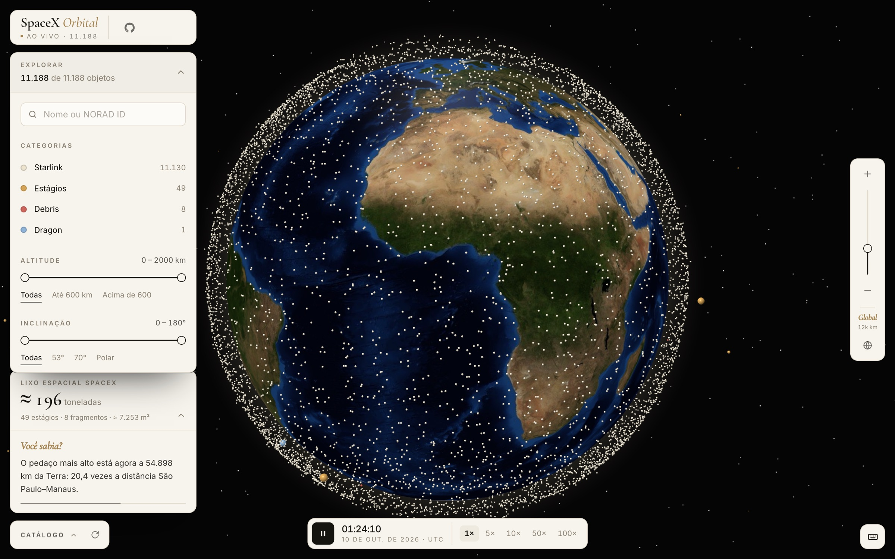
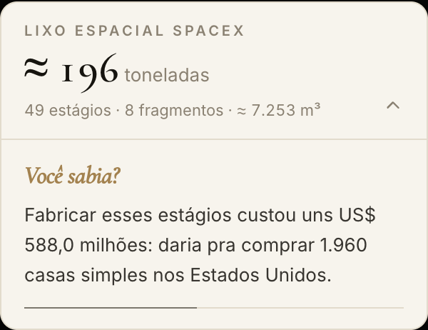

# SpaceX Orbital

> Todos os objetos da SpaceX em órbita, em tempo real, num globo 3D. Incluindo o lixo que ela deixou lá em cima.




## Um pouco de história

Este repositório foi um dos meus primeiros projetos de frontend. A versão original, de 2019, era uma página simples com React e um backend Django que listava os lançamentos passados e futuros da SpaceX. Na época, a empresa estava no auge do hype: foguetes pousando de pé, Falcon Heavy levando um Tesla para o espaço, a promessa de Marte logo ali.

Sete anos depois, o projeto ganhou uma versão 2, escrita lado a lado com agentes de IA, numa geração de ferramentas que mal existia quando a primeira foi feita. A SpaceX também mudou: virou dona de mais da metade dos satélites ativos do planeta com a Starlink, ao mesmo tempo em que acumula estágios abandonados, desconfiança e um brilho bem menos inocente do que em 2019. A v2 tenta mostrar as duas coisas: o tamanho do avanço e o rastro que ele deixa.

| v1 · 2019 | v2 · 2026 |
| --- | --- |
| [](https://github.com/lucasrafaldini/SpaceXLaunches/wiki/Vers%C3%A3o-1-(2019)) | [](docs/screenshots/v2-satellite.jpg) |

A v1 continua no histórico do Git. Ela tem um artigo próprio na wiki, com capturas e detalhes de como era feita: **[Versão 1 (2019)](https://github.com/lucasrafaldini/SpaceXLaunches/wiki/Vers%C3%A3o-1-(2019))**.

## O que tem na v2

- **Mais de 11 mil objetos SpaceX ao vivo**: toda a constelação Starlink, estágios Falcon 9 / Falcon Heavy, fragmentos e cápsulas Dragon, propagados com SGP4 e animados a 60 fps.
- **Globo 3D interativo**: zoom pela roda do mouse sincronizado com uma régua de zoom, hover com detalhes e clique para abrir a ficha orbital completa (altitude, velocidade, elementos orbitais e traçado da órbita).
- **Seguir satélite**: a câmera acompanha o objeto selecionado.
- **Controle do tempo**: tempo real ou acelerado até 100×.
- **Filtros** por categoria, altitude, inclinação e busca por nome ou NORAD ID.
- **"Você sabia?"**: quanto lixo espacial a SpaceX deixou em órbita (massa e volume estimados), convertido em unidades de medida nacionais. Fiat Marea, Uno Mille, estátuas do Borba Gato, Kombis, capivaras, casas nos EUA, apartamentos do Minha Casa Minha Vida e outras. As comparações giram sozinhas e algumas usam a posição ao vivo dos objetos.

## Telas

| Ficha do satélite e traçado da órbita | Filtros |
| --- | --- |
|  |  |



**"Você sabia?"**: o lixo espacial da SpaceX em órbita convertido em unidades brasileiras. As comparações giram a cada 8 segundos.

<br clear="right">

## Como rodar

Requer Node 20+.

```bash
npm install
npm run dev
```

Abra http://localhost:3000.

```bash
npm run build     # build de produção em dist/
npm run preview   # serve o build localmente (com o mesmo proxy de dados)
npm run lint
```

## Dados

Os elementos orbitais vêm da [CelesTrak](https://celestrak.org):

| Fonte | Conteúdo |
| --- | --- |
| `sup-gp.php?FILE=starlink` | Constelação Starlink (efemérides fornecidas pela própria SpaceX) |
| `gp.php?NAME=FALCON` | Estágios e fragmentos de Falcon 9 / Falcon Heavy |
| `gp.php?NAME=DRAGON` / `NAME=STARSHIP` | Cápsulas Dragon e Starship em órbita |

A CelesTrak atualiza os dados a cada 2 horas e bloqueia downloads repetidos nesse intervalo. Por isso há cache em dois níveis:

1. **Servidor** (`vite.config.ts`): um middleware em `/api/celestrak` e `/api/celestrak-sup` guarda as respostas em disco por 2 h e usa a última cópia válida quando a CelesTrak recusa a requisição.
2. **Navegador**: IndexedDB. Visitas seguintes abrem instantaneamente com o catálogo salvo e atualizam em segundo plano.

> **Deploy:** em hospedagem estática, as rotas `/api/celestrak*` precisam de um proxy equivalente (uma função serverless, por exemplo) com o mesmo cache.

### Sobre o lixo espacial

"Lixo" aqui são os objetos SpaceX sem função catalogados pela CelesTrak: estágios superiores abandonados (`R/B`) e fragmentos (`DEB`). O catálogo público não informa massa, então os números são **estimativas** por tipo de objeto: estágio superior ≈ 4 t, fragmento ≈ 50 kg. As premissas e as unidades de comparação estão em [`src/lib/spaceJunk.ts`](src/lib/spaceJunk.ts).

## Como funciona

- **Propagação em Web Worker** (`src/workers/propagation.worker.ts`): o SGP4 roda fora da thread principal. A cada tick, o worker envia um buffer compacto com posição e velocidade de cada objeto, e a thread principal extrapola entre os ticks. O movimento fica suave sem propagar 11 mil órbitas a cada quadro.
- **Renderização** (`src/hooks/useGlobe.ts`): [globe.gl](https://github.com/vasturiano/globe.gl) / three.js. Os satélites são *point sprites* com shader de esfera: um vértice por objeto, numa única chamada de desenho.
- **Estado**: Zustand. Dados de alta frequência (câmera, hover, posições para o renderizador) ficam fora do React, para não re-renderizar a interface a cada quadro.
- **Interface**: React 19, Tailwind CSS 4 e TypeScript, com Vite.

## Licença

[MIT](LICENSE) © 2019–2026 Lucas Rafaldini
